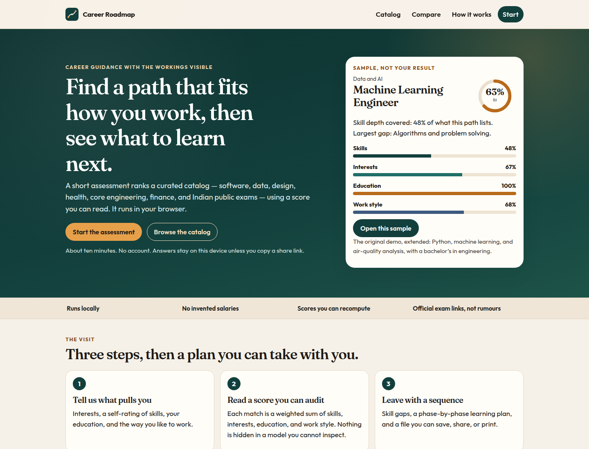
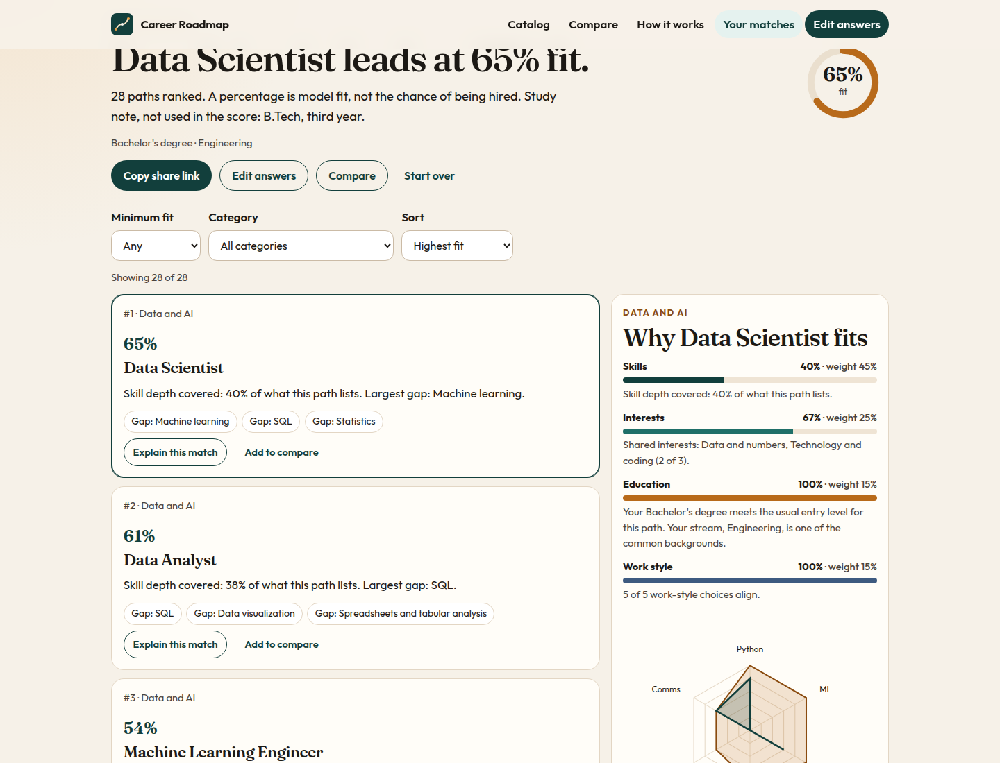
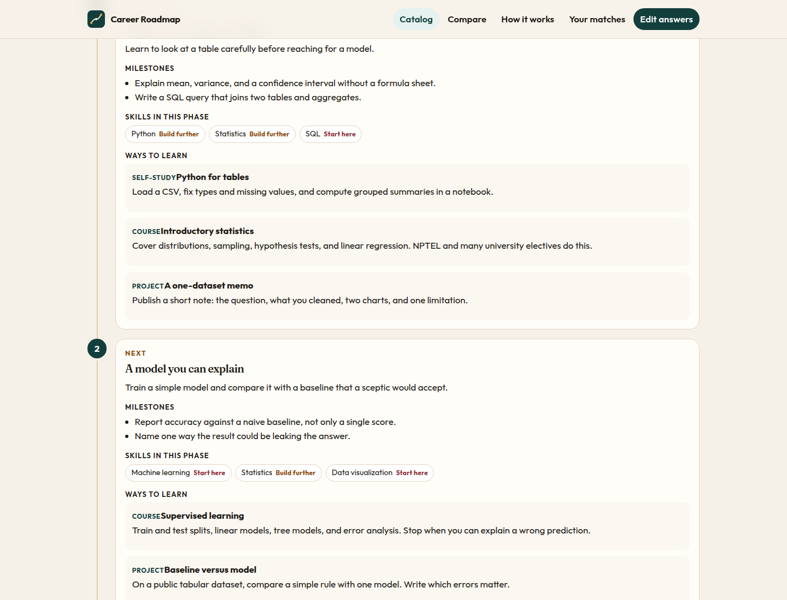
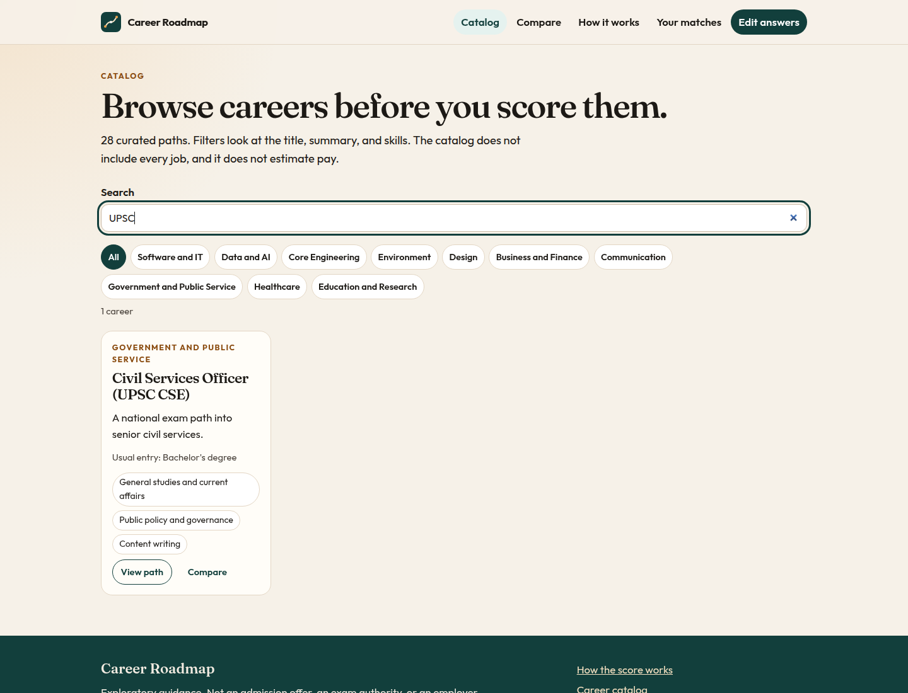
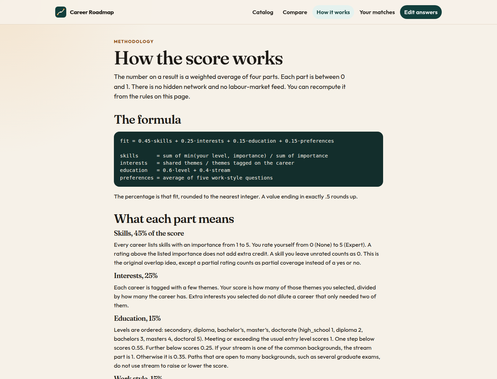
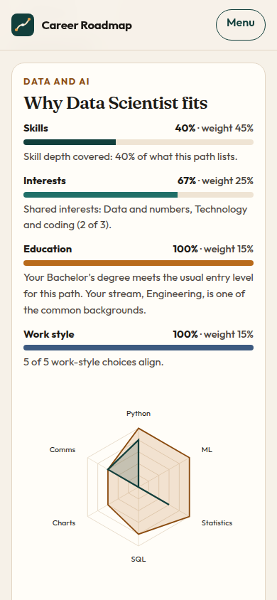

# Career Roadmap

An explainable career assessment you can run in the browser. It ranks a curated catalog from your skills, interests, education, and work style, then lays out skill gaps and a learning sequence you can save, share, or print.

**Live site:** [https://chan424.github.io/career-roadmap-ai/](https://chan424.github.io/career-roadmap-ai/)

No account, no API key, and no invented salary figures. Scoring stays on your device.



## What you can do

- Walk a four-step assessment: interests, self-rated skills, education, and work style.
- Read ranked matches with a percentage, a plain-language reason, and the four-part breakdown.
- See a radar chart of skill fit and a gap table.
- Open a phase-by-phase roadmap (skills, courses and certifications by type, projects, milestones), personalised when you have a saved profile.
- Search and filter the catalog, and compare up to three careers.
- Copy a share link, keep the result in this browser, download JSON, or print / save as PDF.
- Read [how the score is calculated](https://chan424.github.io/career-roadmap-ai/how-it-works), including what it refuses to claim.







The catalog leans on paths students in India actually weigh: software and data, core engineering, design, healthcare (including the MBBS route), finance and chartered accountancy, teaching, and public exams such as UPSC CSE, SSC CGL, and bank PO. Exam pages link to the official body and tell you to trust the current notification.

## How the score works

The original `recommend.py` scored a career as the share of its required skills you listed. That demo is unchanged:

| Career | Overlap for Python, Machine Learning, AQI Analysis |
| --- | --- |
| Data Scientist | 50% |
| Environmental Analyst | 50% |
| IoT Engineer | 25% |
| Software Engineer | 0% |

The site generalises that idea. A fit is a weighted sum:

```text
fit = 0.45·skills + 0.25·interests + 0.15·education + 0.15·preferences
```

Skill credit is `min(your level, listed importance)`, so rating yourself above what the path asks for does not inflate the score. Interests are the share of that career’s themes you selected. Education gives partial credit when you are close on level or stream. “No preference” on a work-style question stays neutral. The percentage is the fit rounded to the nearest integer. It is not a hiring probability.

Weights and partial-credit constants live in [`src/data/model.json`](src/data/model.json). The same file drives the website and the command-line scorer, so they cannot drift quietly. Full notes and limitations are on the How it works page.



## Run it locally

The dev and preview servers use the GitHub Pages base path, so open `/career-roadmap-ai/`.

```bash
npm install
npm test
npm run lint
npm run dev
```

Dev server: [http://localhost:5173/career-roadmap-ai/](http://localhost:5173/career-roadmap-ai/)

```bash
npm run build
npm run preview
```

Preview: [http://localhost:4173/career-roadmap-ai/](http://localhost:4173/career-roadmap-ai/)

Python is the standard library only:

```bash
python recommend.py
python recommend.py --skills python=4,sql=3 --interests data,technology \
  --level bachelors --stream engineering \
  --sector private --setting hybrid --focus data --structure flexible --pace steady
python -m unittest test_recommend.py
```

## Deploy

[`.github/workflows/pages.yml`](.github/workflows/pages.yml) runs the Python tests, lint, unit tests, and production build on pull requests and on pushes to `main`. A push to `main` also uploads `dist/` and deploys it with `actions/deploy-pages`.

The Vite `base` is `/career-roadmap-ai/`, which matches a project site. A copy of `index.html` is written to `404.html` so client-side routes such as `/careers/data-scientist` still load on GitHub Pages.

In the repository settings, set **Pages → Build and deployment → Source** to **GitHub Actions** once. The first successful run on `main` publishes [https://chan424.github.io/career-roadmap-ai/](https://chan424.github.io/career-roadmap-ai/).

## Limits

Self-ratings are subjective. The catalog is a sample, not the labour market. Pay, vacancies, and hiring chances are omitted because this project does not fetch a cited source for them. Official exam and licensing notices override anything written here.



## License

[MIT](LICENSE)
